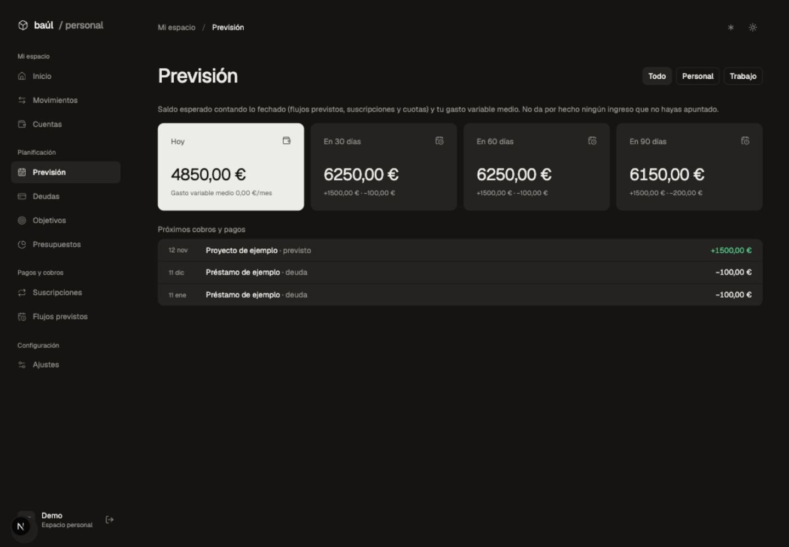

# Baúl

Finanzas personales y de trabajo en un solo sitio. Cuentas de Wise, Mercury y manuales, movimientos categorizados, suscripciones y herramientas para planificar tu dinero.

[Abre Baúl](https://baul.raulcano.dev)

## Interfaz

Cada tarea tiene su página: Previsión, Deudas, Objetivos, Presupuestos y Flujos previstos. En móvil, la barra **Inicio · Movimientos · Cuentas · Más** da acceso a todas las secciones.

Capturas con **datos ficticios**, sin información bancaria real:




## Desarrollo

Necesitas Node.js 22.12+ y pnpm 10.

```sh
pnpm install
cp .env.example .env
```

Genera un secreto con `openssl rand -base64 32` y guárdalo como `BETTER_AUTH_SECRET` en `.env` y `.dev.vars` (el mismo valor en ambos).

```sh
pnpm db:migrate:local
pnpm dev
```

Abre [localhost:43871](http://localhost:43871). El primer usuario puede registrarse y queda como admin; después, el registro requiere un código de invitación de un solo uso que el admin genera en el panel Admin. También puedes crear un usuario local con `pnpm user:create <usuario> <email>`.

## Comandos

| Comando                  | Uso                                  |
| ------------------------ | ------------------------------------ |
| `pnpm check`             | ESLint y TypeScript                  |
| `pnpm build`             | Compilación de Next.js               |
| `pnpm preview`           | Compila y ejecuta el Worker en local |
| `pnpm db:generate`       | Genera migraciones del esquema       |
| `pnpm db:migrate:remote` | Aplica migraciones a producción      |
| `pnpm run deploy`        | Compila y despliega en Cloudflare    |

Detén `pnpm dev` antes de compilar, previsualizar o desplegar: comparten la carpeta `.next`.

## Arquitectura

Next.js · React · Tailwind CSS · shadcn/ui · tRPC · Drizzle · Better Auth. Alojado en Cloudflare Workers, con una base D1 y sincronización bancaria diaria a las 05:00 UTC.

- `src/server/finance/`: lógica financiera compartida por la web y los agentes.
- `src/server/api/routers/`: API tRPC protegida por sesión.
- `src/server/tools/`: herramientas MCP.
- `src/server/db/schema.ts` y `drizzle/`: esquema y migraciones.
- `wrangler.jsonc`: bindings, dominio y cron.

El servidor MCP está en `https://baul.raulcano.dev/api/mcp`, con OAuth y permisos de lectura/escritura. Para Claude Code:

```sh
claude mcp add --transport http baul https://baul.raulcano.dev/api/mcp
```

En producción, configura `BETTER_AUTH_SECRET` con `pnpm wrangler secret put BETTER_AUTH_SECRET`. Las credenciales bancarias se gestionan desde Ajustes. Los archivos de entorno y la base local no se incluyen en Git.

## Enable Banking

En Ajustes → Bancos → Conectar o renovar con Enable Banking se elige el país y el banco. El usuario autoriza el acceso en el proveedor; Baúl importa saldos y movimientos confirmados. La autorización debe renovarse cuando caduque. Los identificadores de cuentas se mantienen entre sesiones para conservar el historial, distinguiendo las divisas incluso si comparten IBAN.

Configura estos secretos en el Worker (nunca en el repositorio):

- `ENABLE_BANKING_APP_ID`: identificador de la aplicación de producción.
- `ENABLE_BANKING_PRIVATE_KEY`: clave RSA privada PKCS#8 en formato PEM.
- `ENABLE_BANKING_OWNER_USER_ID`: ID del usuario de Baúl autorizado a utilizar esta aplicación restringida. Sin coincidencia exacta, el servidor deniega el acceso.

Registra `https://baul.raulcano.dev/api/banking/enablebanking/callback` como redirect URL. La clave y los permisos de cada conexión se guardan cifrados; el navegador nunca recibe la clave. La vinculación de cuentas en el panel de Enable Banking no sustituye la autorización desde Baúl. El modo restringido no habilita cuentas de terceros.

Validación del adaptador (Node 22.12+): `node --experimental-strip-types --test tests/enablebanking.test.mjs`.

Los movimientos sin `entry_reference` estable se rechazan con un aviso, en lugar de generar identificadores que puedan duplicar o fusionar operaciones. La sincronización automática utiliza el mismo adaptador que la manual.
